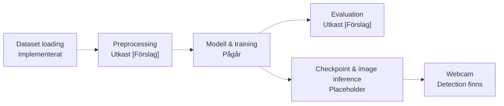

(Tips i VS Code) Öppna i Markdown Preview: Ctrl + Shift + V

# Facial Emotion Recognition — systemöversikt & status

Projekt inom **SSY340 Deep Machine Learning** · Uppdaterad **13 oktober 2026**.

## Mål [Förslag]
1. **Grundpipeline:** Läsa dataset, träna, utvärdera och klassificera en bild.
2. **Baseline:** Träna och utvärdera modellen på sju emotionsklasser.
3. **Adaptation:** Introducera den åttonde klassen med varierande mängd training data.
4. **Jämförelse:** Utvärdera nya och tidigare klasser och jämför med adaptation som använder all tillgänglig training data för den nya klassen.
Möjliga utökningar [Förslag]: Webcam-demo och experiment med synthetic data.

## Pipeline & status

Streckade pilar visar kopplingar som ännu saknas.



Alla Python-filer nedan ligger i `src/`. **[Förslag]** markerar lösningar som ännu inte är beslutade. **Utkast** betyder att kod finns för granskning, men ännu inte är integrerad i training-pipelinen.

| Pipeline-steg | Befintlig fil | Föreslagen fil [Förslag] |
|---|---|---|
| Dataset loading | `data_loader.py`<br><sub>Läser bilder och annotations</sub> | |
| Preprocessing | `data_loader.py`<br><sub>Stöd för transform</sub><br>`preprocessing.py`<br><sub>Utkast [Förslag] — image transforms från HA3</sub> | |
| Modell | `models.py`<br><sub>[Förslag] Gemensamt gränssnitt för sex arkitekturer</sub> | |
| Training | `training.py`<br><sub>Gemensam training-loop</sub><br>`train_models.py`<br><sub>Tränar en modell åt gången</sub> | |
| Evaluation | `evaluate.py`<br><sub>Utkast [Förslag] — accuracy, valfri loss och predictions från HA2–HA4</sub> | |
| Image inference | `classifier.py`<br><sub>classify_face() är en placeholder</sub> | |
| Webcam | `face_detection.py`<br><sub>MTCNN, face crops och visning</sub> | |
| Entry point | `main.py`<br><sub>Tom fil</sub> | |


### HA-baserade utkast [Förslag]

`preprocessing.py` och `evaluate.py` bygger på officiella/inlämnade HA-versioner, med projektspecifika anpassningar. Exakta cellreferenser finns överst i respektive fil.

| Utkast | Källa | Kontroll och begränsning |
|---|---|---|
| `preprocessing.py` | `HA3/HA3.ipynb`, cell 30, 41 och 92 | Kontrollerat med dataset-exempel. Default: 48 × 48 grayscale, valfri normalization/flip. Label processing återstår. |
| `evaluate.py` | `HA2/HA2.ipynb`, cell 61; `HA3/HA3.ipynb`, cell 55; `HA4/HA4-Part2.ipynb`, cell 50 | Kontrollerat med små syntetiska testdata. Kräver class targets; precision/recall/F1 återstår. |

Källorna finns i `SSY340-group-92`; cellnummer räknas från 1 inklusive Markdown. Ingen av komponenterna är ännu verifierad i ett komplett training-flöde.

## Dataset & preprocessing

FER+ finns som **48 × 48 grayscale-PNG** i `data/train`, `data/valid` och `data/test`. `FerDataset` returnerar en PIL image och tio label counts: åtta emotionskategorier samt `unknown` och `NF`.

**Grundversion [Förslag]:**

- Majority voting + cross-entropy: nollställ kategorier med högst en röst, kräv strikt majoritet bland kvarvarande röster och exkludera osäkra bilder samt vinnande `unknown`/`NF`.
- Gemensamma deterministiska image transforms för training, validation och inference; ingen random augmentation initialt.
- Input size, channels och normalization väljs med modellen. **224 × 224 är inget krav från datasetet**; uppskalning tillför inga bilddetaljer.

[Förslag] Vid sju-klassträning väljs target bland alla åtta emotionsklasser innan bilder med held-out target exkluderas.

## Training & jämförelse

**En training-loop:** `training.py` bygger direkt på Arons original. Endast device och checkpoint-sökvägar är generaliserade; originalets training-beräkningar och utskrifter behålls. Scriptdelen ligger i `train_reference()` för säker import. `train_models.py` skickar valda modeller till denna loop; `compare.py` tränar aldrig.

### Träna en modell

```powershell
uv run python src/train_models.py
# Eller välj en modell:
uv run python src/train_models.py small_cnn --epochs 30
```

Default körs ResNet-18, MobileNetV3-Small, SqueezeNet, SmallCNN och BalancedCNN i följd. **Pretrained kandidater följer Arons steg:** head (4 epochs, LR 1e-3) → sista blocket + head (6 epochs, LR 1e-4/5e-4) → hela modellen (8 epochs, lägre layer learning rates). Layer-grupperna anpassas i `models.training_stages()`. Custom CNN tränas helt från scratch i 18 epochs med LR 1e-3. `--epochs` anger total budget; andra budgetar fördelas proportionellt för pretrained modeller (minst 3). Device väljs automatiskt.

Samma original-loop, losses, AdamW och augmentation används. Som i originalet fortsätter BatchNorm-statistik uppdateras i training mode även när weights fryses. Input-recept och initiering skiljer sig fortfarande; jämförelsen visar praktiskt resultat, inte identiska startförutsättningar. Bästa checkpoint över alla steg sparas; nästa steg fortsätter från föregående stegs sista weights enligt originalet.

```text
checkpoints/
├── best_resnet.pth                 # Arons befintliga referens
└── modelspeedtest/
    ├── small_cnn/
    │   ├── best_small_cnn.pth
    │   ├── intermediate_small_cnn.pth
    │   └── config.json
    ├── balanced_cnn/
    ├── resnet18/
    ├── comparison/
    └── summary.csv
```

**En ny training ersätter endast den valda modellens senaste körning.** `best` väljs med validation loss; `intermediate` sparas var 100:e batch enligt originalet och innehåller weights, optimizer-state och epoch; det är inte nödvändigtvis sista batchen. CLI-resume är ännu inte implementerat. Originalet skriver train/validation loss; weighted och unweighted loss är inte direkt jämförbara. Ingen ny epoch-historikfil skapas.

### Jämför sparade modeller

```powershell
uv run python src/compare.py
```

Laddar tillgängliga checkpoints och Arons `checkpoints/best_resnet.pth` som Reference. Ingen training eller pretrained-download. Äldre `run-*`-kataloger används som fallback om en modell saknar ny checkpoint; de tas inte bort. Endast senaste jämförelseresultaten skrivs till `summary.csv` och `comparison/*.json`.

`--models small_cnn balanced_cnn` begränsar kandidater, `--no-reference` utesluter referensen och `--checkpoint modell=sökväg` väljer en specifik sparad modell. `--device cpu` mäter på CPU.

- Samma FER+-testset och class order, med sparad preprocessing per modell. Ingen testdata används under training. Andra checkpoint-formats och sju-klasmodeller behöver adapter.
- Model recipes: torchvision input 112 med ImageNet normalization; custom CNN input 48 utan normalization. `balanced_cnn` har 32/64/128 channels och två 3 × 3 convolutions per block (288 488 parameters).
- Tabellen visar training-typ, accuracy, macro precision/recall/F1 och classifier-latency. Resurstabellen visar Conv/Linear MACs, weights/buffers och extra CUDA peak allocations.
- Latency gäller ett face crop efter warmup; detection, preprocessing, transfers och total webcam-latency ingår inte. Kort training visar inte slutlig accuracy-potential.

Arons separata ResNet-50-upplägg (4/6/8 epochs) körs fortfarande med `uv run python src/training.py`; dess checkpoints ligger kvar på ursprunglig plats.

## Öppna beslut

Jämförelsen skriver även en resurstabell: **Conv/FC MMAC** (miljoner multiply-accumulates i Conv/Linear), **State MiB** (parameters + buffers) och **Extra GPU MiB** (extra peak tensor allocations under ett forward pass efter warmup). MAC-estimatet exkluderar övriga operations; GPU-måttet är inte totalt minnesbehov. CPU peak memory och end-to-end webcam latency mäts ännu inte. Värdena sparas även i CSV/JSON.

| Beslut | Fråga inför nästa möte |
|---|---|
| **Modell** | ResNet-18? Pretrained weights eller training från scratch? |
| **Preprocessing** | Bekräfta majority-policy samt input size, channels och normalization. |
| **Klasser** | Sju klasser direkt i grundversionen? Vilken emotion hålls utanför? |
| **Checkpoint** | Hur sparas weights, class order och preprocessing-konfiguration? |
| **Senare experiment** | Data budgets, adaptation-metod, full-data-jämförelse och gemensamma splits mellan grupperna. |

## Nästa milstolpe & ansvar

Grundflödet är klart när vi kan **läsa ett batch → köra training → spara/återläsa modellen → mäta accuracy på separat data → prediktera en bild**. Webcam behövs inte för denna milstolpe.

| Ansvarig | Fokus enligt mötet 12 oktober |
|---|---|
| **Aron** | Modell och training loop |
| **Emil** | Systemöversikt, dokumentation och komponenternas gränssnitt |
| **Gemensamt** | Startkonfiguration och verifiering av grundflödet |

Senare utökas evaluation med precision, recall och F1 för nya och tidigare klasser.

## Setup & körning

Python **3.12**, uv och repositoryts root som arbetskatalog:

```powershell
uv sync
```

PyTorch **2.2.0** och torchvision **0.17.0** är konfigurerade för CUDA **12.1**. Detection väljer CUDA om tillgängligt, annars CPU.

| Kommando | Funktion |
|---|---|
| `uv run python src/data_loader.py` | Visar en testbild och skriver dess annotations |
| `uv run python src/face_detection.py` | Visar stillbildsdetection, sedan webcam när bildfönstret stängts. Avsluta med **q** |

Webcam visar placeholder-text; sannolikheten gäller **face detection**, inte emotion confidence. Training-/evaluation-kommandon tillkommer.


Install dependencies
```
uv sync
```

run with 
```
uv run main.py
```
Initialize virtual environment before using sync
```
uv venv
```

To add package:
```
uv add torch
```


## Referenser

- [Microsoft FER+](https://github.com/microsoft/FERPlus) · [Majority-policy](https://github.com/microsoft/FERPlus/blob/master/src/ferplus.py)
- [torchvision ResNet-18](https://github.com/pytorch/vision/blob/v0.17.0/torchvision/models/resnet.py) · [Preprocessing preset](https://github.com/pytorch/vision/blob/v0.17.0/torchvision/transforms/_presets.py)

*Uppdatera status och datum när ett steg implementeras eller verifieras.*
